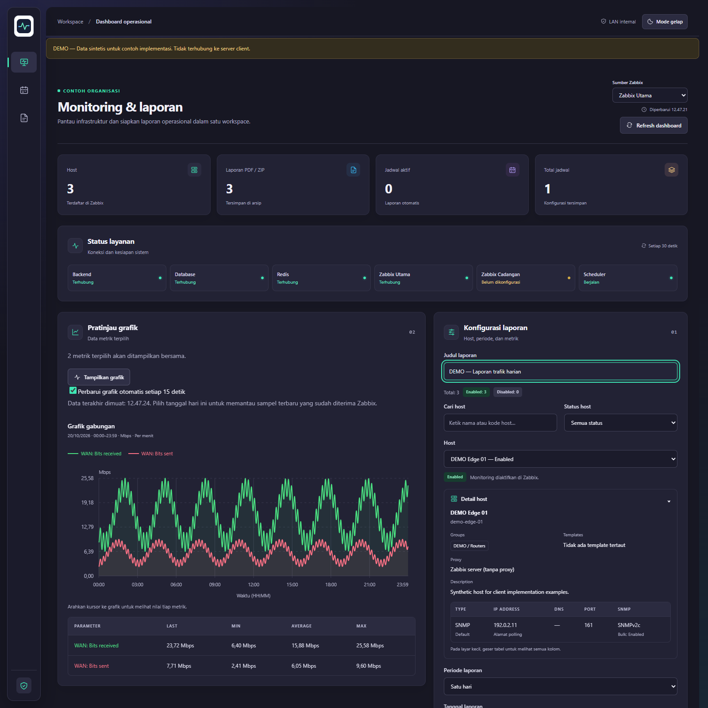
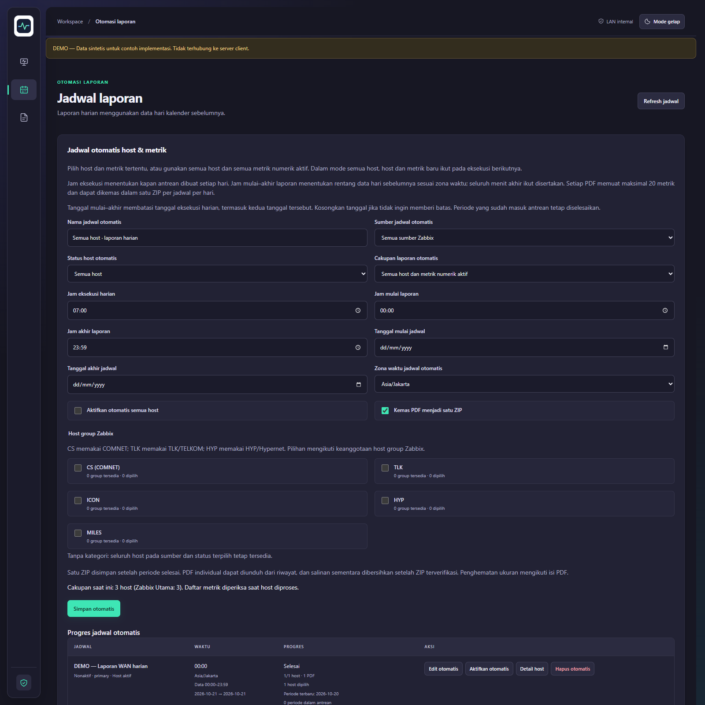
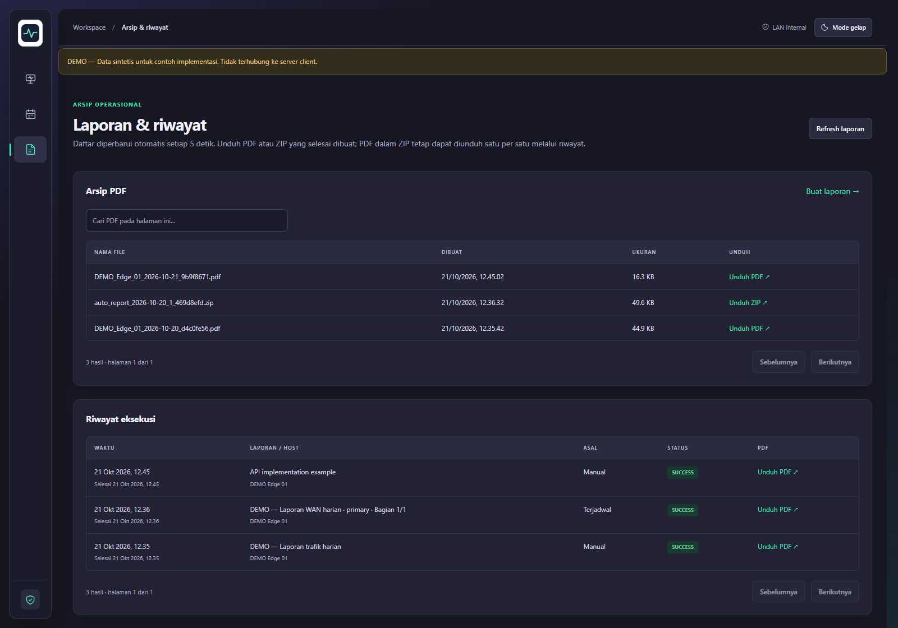

# Zabbix Report Exporter — Client Starter

Source lengkap untuk monitoring Zabbix, laporan PDF, jadwal harian, arsip ZIP, dan akses admin. Edisi ini memakai branding generik serta konfigurasi awal kosong. Contoh host, IP, dan grafik pada demo seluruhnya sintetis.

## Coba demo tanpa Zabbix

Prasyarat: Docker Engine/Docker Desktop dengan Docker Compose v2. Jalankan dari folder hasil ekstraksi:

```sh
docker compose -p zabbix-starter-demo -f docker-compose.demo.yml up -d --build --wait
```

Buka **http://localhost:5011**. Pilih **DEMO Edge 01**, centang **WAN: Bits received** dan **WAN: Bits sent**, lalu pilih mode grafik gabungan dan klik **Tampilkan grafik**. Isi judul untuk mengekspor PDF. Jadwal otomatis awalnya kosong dan tidak aktif. Tidak ada akun atau password client pada demo.

Demo hanya diterbitkan pada loopback `127.0.0.1`, menggunakan database/volume tersendiri, login dinonaktifkan, dan API Zabbix simulasi. Banner DEMO selalu tampil. Jangan gabungkan file demo dengan Compose produksi. Untuk menghentikan demo tanpa menghapus datanya:

```sh
docker compose -p zabbix-starter-demo -f docker-compose.demo.yml down
```

## Instalasi client dengan database kosong

Prasyarat tambahan: Python 3.10+ untuk generator konfigurasi; API token Zabbix dengan izin baca pada host, item, history/trend, trigger, dan event yang dibutuhkan. Backend mendukung deteksi versi API Zabbix dan dua sumber independen.

```sh
python scripts/configure.py --url https://zabbix.client.example/api_jsonrpc.php
docker compose -f docker-compose.yml -f docker-compose.prod.yml up -d --build --wait
```

Pada Linux gunakan `python3` bila perintah `python` tidak tersedia. Token diminta melalui input tersembunyi. Generator membuat password database dan admin acak, menyimpannya pada `.env` lokal dengan izin terbatas, dan menolak menimpa konfigurasi lama.

Buka **http://localhost:5010**. Username awal **admin**; ambil password bootstrap dari `AUTH_BOOTSTRAP_PASSWORD` pada `.env` lokal. Login pertama mewajibkan perubahan password. Database baru tidak berisi akun lama, sesi, riwayat akses, jadwal, atau laporan. Jangan memakai volume dari instalasi lain bila menginginkan instalasi kosong.

Edit `HTTP_PORT` untuk mengganti port, dan `COMPOSE_PROJECT_NAME` sebelum instalasi pertama jika menjalankan beberapa client pada mesin yang sama. Penggantian nama project juga memilih volume berbeda. Aktifkan TLS pada konfigurasi Nginx untuk server HTTPS dan gunakan `AUTH_COOKIE_SECURE=true`. Login produksi tetap aktif; pengaturan demo tidak diterapkan ke produksi.

## Panduan dan base code

- [Implementasi, arsitektur, dan peta source](docs/IMPLEMENTATION.md)
- [Contoh API Python yang dapat dijalankan](examples/client.py)
- [Template spesifikasi penawaran dan serah terima](docs/PRODUCT.md)
- [Lisensi dan distribusi komersial](docs/LICENSING.md)
- [Operasional, backup, dan pemulihan](docs/OPERATIONS.md)

Branding berada di `frontend/lib/branding.ts` dan logo di `frontend/public/brand/logo.svg`. Ganti keduanya lalu build ulang frontend. Atribusi pengembang asli dan lisensi tersedia di `NOTICE` serta `LICENSE`.

## Contoh tampilan

Gambar pada folder `docs/images/` diambil dari aplikasi demo yang berjalan. Data dan nama host adalah contoh, bukan data client.





Tampilan tambahan: [grafik gabungan](docs/images/combined-chart-demo.png) dan [grafik ponsel](docs/images/mobile-chart-demo.png).

## Perilaku data

Setelah ditampilkan, grafik dapat mengambil ulang data setiap 15 detik selama tab terlihat. Daftar laporan diperbarui setiap 5 detik. Pembaruan mengikuti interval pengumpulan dan retensi Zabbix. PDF adalah snapshot saat ekspor. Maksimal 20 metrik per PDF dan 90 hari per permintaan; satu ZIP dapat mengemas seluruh PDF jadwal. History per menit tidak diganti data sintetis atau trend per jam ketika kosong.

## Lisensi

Source menggunakan **MPL-2.0**, termasuk ketentuan penyediaan source untuk bagian yang dicakup saat didistribusikan. Paket dapat ditawarkan bersama jasa implementasi, kustomisasi, dan dukungan tanpa mengganti hak penerima menurut MPL. Baca [panduan lisensi](docs/LICENSING.md) sebelum menyusun penawaran.
