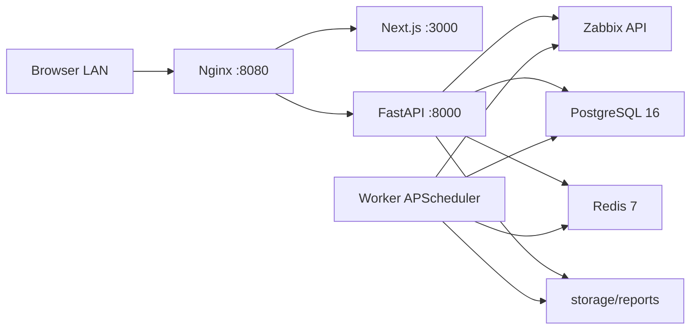

# Zabbix Report Exporter

Aplikasi LAN internal untuk membaca metrik Zabbix, membuat laporan PDF, dan menjalankan laporan harian. MVP mencakup monitoring, laporan manual, jadwal harian, arsip PDF, riwayat eksekusi, serta backup dan uji pemulihan. Login operator berada pada tahap berikutnya, sesuai batas MVP yang disepakati.

## Alur penggunaan

1. Buka `http://localhost:8080` atau alamat LAN komputer server.
2. Pada **Monitoring**, pilih host, periode, dan satu atau beberapa metrik numerik aktif. Grafik menampilkan satu metrik pilihan; ekspor PDF memuat seluruh metrik yang dipilih.
3. Pada **Jadwal**, buat atau edit laporan harian, atur timezone dan waktu, lalu aktifkan. **Jalankan sekarang** memakai data hari kalender sebelumnya dan menandai jadwal sudah dijalankan hari ini, termasuk saat jadwal sedang nonaktif.
4. Pada **Laporan**, unduh PDF dan tinjau riwayat. Penghapusan jadwal mempertahankan PDF dan identitas laporan di riwayat.

Laporan dengan sebagian metrik kosong diberi status `PARTIAL` dan peringatan di PDF serta riwayat. Jika seluruh metrik kosong, pembuatan gagal dan tidak menghasilkan PDF kosong. Jadwal yang gagal mencoba kembali setelah lima menit; waktu retry tersimpan di PostgreSQL. Status scheduler berasal dari heartbeat worker di Redis. Worker menandai eksekusi terputus yang kedaluwarsa sebagai FAILED, dengan pemeriksaan lock untuk melindungi jadwal yang masih aktif.

Batas laporan: maksimal 20 metrik dari satu host, periode 90 hari, dan 50.000 titik history per metrik. Periode panjang mengutamakan trend per jam. Statistik trend menggunakan minimum/maksimum sebenarnya dan rata-rata berbobot jumlah sampel. Pengambilan history padat membagi rentang waktu agar tidak diam-diam berhenti pada 5.000 titik. Retensi data mengikuti konfigurasi Zabbix.

## Arsitektur



Hanya Nginx yang menerbitkan port host. PostgreSQL menyimpan jadwal dan riwayat; Redis menyimpan heartbeat; direktori `storage/reports` menyimpan PDF.

## Menjalankan produksi

Prasyarat: Docker Desktop dengan Linux containers, Docker Compose v2, akses jaringan ke Zabbix, dan API token baca dengan hak host/item/history/trend yang diperlukan.

```powershell
Copy-Item .env.example .env
# Edit .env: ganti password, URL Zabbix, dan API token.
docker compose -f docker-compose.yml -f docker-compose.prod.yml up -d --build --wait
docker compose -f docker-compose.yml -f docker-compose.prod.yml ps
```

Gunakan nilai password yang sama pada `POSTGRES_PASSWORD` dan `DATABASE_URL`. Karakter khusus pada password di URL harus di-URL-encode. Mengubah variabel password tidak mengganti password PostgreSQL pada volume yang sudah terisi. Simpan `.env` di server; berkas tersebut diabaikan Git.

Backend membuat tabel dan menambahkan kolom secara idempotent pada startup. Migrasi memakai transaction advisory lock sehingga backend dan worker dapat memulai bersama. Penerapan versi ini menambah kolom retry/error dan identitas riwayat; jadwal serta PDF sebelumnya dipertahankan.

`/health` memeriksa proses API, `/health/ready` memeriksa kesiapan database. Backend, frontend, worker, PostgreSQL, dan Redis memiliki healthcheck produksi. **Status layanan** di dashboard juga memeriksa koneksi Zabbix serta heartbeat scheduler.

## Pengembangan dan pengujian

```powershell
docker build -t codex-zabbix-backend-mvp:20261007 backend
docker build -f frontend/Dockerfile.prod -t codex-zabbix-frontend-mvp:20261007 frontend
powershell.exe -NoProfile -ExecutionPolicy Bypass -File scripts/test-regressions.ps1
```

Pengujian backend membuat PostgreSQL dan Redis sementara pada network internal, memakai data uji, lalu membersihkan resource yang dibuatnya. Container produksi tidak dipakai.

Pengujian browser memakai API mock sehingga tidak mengubah jadwal produksi. Node.js 24 dan Chrome lokal diperlukan untuk konfigurasi default:

```powershell
npm.cmd ci --prefix e2e
powershell.exe -NoProfile -ExecutionPolicy Bypass -File scripts/test-browser.ps1
```

Untuk Edge, set `$env:E2E_BROWSER_CHANNEL="msedge"`. Browser tests memeriksa alur pada desktop dan emulasi layar ponsel. Hasil ada di `e2e/playwright-report`; screenshot dan trace kegagalan ada di `e2e/test-results`.

Untuk mengedit frontend secara lokal: jalankan `npm.cmd ci` dan `npm.cmd run dev` di `frontend`. Akses API memerlukan proxy Nginx; browser tests menggunakan frontend container dengan API mock.

## Backup dan pemulihan

```powershell
powershell.exe -NoProfile -ExecutionPolicy Bypass -File scripts/backup-db.ps1
powershell.exe -NoProfile -ExecutionPolicy Bypass -File scripts/test-restore.ps1 -BackupFile "backup/nama-arsip.dump"
```

Backup menghasilkan arsip PostgreSQL custom `.dump` dan arsip PDF `.zip`. Backup lama dipertahankan. Uji restore memulihkan arsip hanya pada database sementara dan memeriksa tabel serta jumlah baris. Pemulihan produksi merupakan tindakan terpisah yang memerlukan pemeriksaan backup, penghentian writer, dan persetujuan penggantian data.

Setelah kedua image lulus pengujian:

```powershell
powershell.exe -NoProfile -ExecutionPolicy Bypass -File scripts/deploy-reviewed.ps1
```

Script menyimpan backup database, image rollback, dan Compose override healthcheck lama, menerapkan backend/frontend/worker berurutan, reload proxy, dan memeriksa endpoint. Kegagalan penerapan memicu pemulihan image sebelumnya; arsip database tidak otomatis ditimpa. Jika HTTP_PORT diubah, berikan parameter -BaseUrl pada script deployment. Detail bukti penerimaan ada di [checklist MVP](docs/mvp-checklist.md), catatan perbaikan sebelumnya di [validasi](docs/perbaikan-dan-validasi.md).

Pengujian tambahan untuk konfigurasi server saat ini:

```powershell
powershell.exe -NoProfile -ExecutionPolicy Bypass -File scripts/test-real-schedules.ps1 -BackupFile "backup/nama-arsip.dump"
node scripts/smoke-live.cjs
```

Script pertama memakai salinan database sementara dan membaca Zabbix nyata. Script kedua memakai host 16500/metrik 917040 dan 917037 pada aplikasi aktif, serta membuat satu PDF manual verifikasi; sesuaikan fixture jika konfigurasi Zabbix berbeda. Bukti pengujian tersimpan di docs/mvp-live-validation.json.

Pada validasi terakhir, drive C hanya memiliki sekitar 280 MB kosong. Tambahkan ruang kosong sebelum penggunaan rutin. Catatan ini terpisah dari kelulusan fitur aplikasi.

## Batas tahap ini

Akses mengikuti LAN tepercaya; login/RBAC belum termasuk. Pengiriman email/WhatsApp, jadwal mingguan/bulanan, HA multi-server, dan kebijakan penghapusan otomatis PDF juga berada pada tahap berikutnya. Klaim selesai berlaku pada kriteria penerimaan MVP yang diuji, bukan jaminan bahwa semua kemungkinan kegagalan perangkat, jaringan, atau data eksternal dapat dieliminasi.

