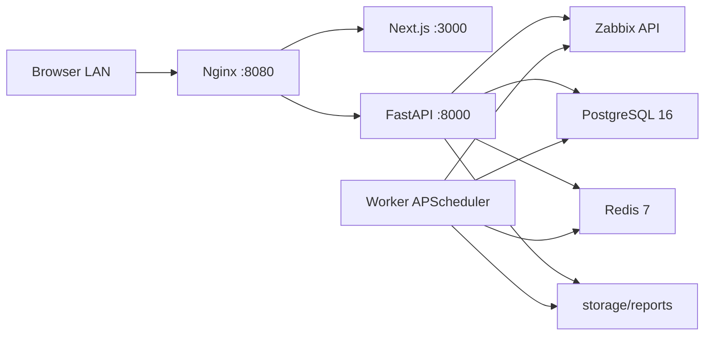

# Zabbix Report Exporter

Aplikasi LAN internal untuk membaca metrik Zabbix, membuat laporan PDF, dan menjalankan laporan harian. MVP mencakup monitoring, laporan manual, jadwal harian, arsip PDF, riwayat eksekusi, serta backup dan uji pemulihan. Login operator berada pada tahap berikutnya, sesuai batas MVP yang disepakati.

Dashboard menggunakan tema **Light enterprise**: latar terang, aksen biru, navigasi samping pada desktop, navigasi ringkas pada ponsel, kartu status layanan, dan grafik dengan area berwarna. Ikon SVG disimpan dalam kode tanpa font atau aset eksternal. Angka ringkasan dan waktu pembaruan berasal dari respons aplikasi.

## Alur penggunaan

1. Buka `http://localhost:8080` atau alamat LAN komputer server.
2. Pada **Monitoring**, pilih server Zabbix, cari host berdasarkan nama/kode, lalu cari satu atau beberapa metrik berdasarkan nama, key, ID, atau unit. Resolusi **per menit** aktif secara default dan tanggal awal adalah hari kemarin. Pilih **Tanggal laporan** untuk periode 00:00–23:59:59 waktu lokal. Grafik memakai sumbu tetap 00:00–23:59 dan kursor menampilkan waktu HH:MM serta nilai sampel. PDF menampilkan nama metrik, grafik, dan satu tabel statistik harian dengan kolom **Interface Parameter, Last, Min, Average, Max**, tanpa daftar Included metrics. Setiap nilai bandwidth memilih satuannya sendiri sesuai besar nilai: **bps, Kbps, Mbps, Gbps, atau Tbps**, dengan dua angka desimal, misalnya Last **498,85 Kbps**, Min **11,58 Kbps**, Average **2,69 Mbps**, dan Max **13,02 Mbps**. Konversi jaringan memakai basis desimal: 1 Kbps = 1.000 bps dan 1 Mbps = 1.000.000 bps. Sumbu grafik tetap memakai satu satuan per grafik. Metrik lain tetap memakai satuan aslinya dengan kolom pertama **Parameter**. **Last** adalah sampel terakhir yang tersedia pada hari itu, bukan rata-rata menit terakhir atau jumlah sampel; jika hanya tersedia trend, kolom Last menampilkan tanda kosong. Periode beberapa hari menghasilkan grafik dan statistik terpisah untuk setiap hari.
3. Pada **Jadwal**, buat atau edit laporan harian, atur timezone dan waktu, lalu aktifkan. **Jalankan sekarang** memakai data hari kalender sebelumnya dan menandai jadwal sudah dijalankan hari ini, termasuk saat jadwal sedang nonaktif.
4. Pada **Laporan**, unduh PDF dan tinjau riwayat. Penghapusan jadwal mempertahankan PDF dan identitas laporan di riwayat.

Untuk laporan beberapa tanggal dalam satu bulan, pilih **Periode laporan → Rentang tanggal dalam satu bulan**, tentukan **Bulan laporan**, **Tanggal awal**, dan **Tanggal akhir**, lalu ekspor PDF. Contoh **Maret 2026, tanggal 18–31** menghasilkan satu PDF untuk 14 hari, dari 18 Maret 00:00 sampai 31 Maret 23:59:59 waktu lokal. Isi PDF diurutkan berdasarkan tanggal: semua metrik tanggal 18, lalu tanggal 19, hingga tanggal 31. Setiap metrik per hari memiliki grafik dan tabel Last, Min, Average, Max sendiri. Hari tanpa data tetap ditampilkan dengan grafik kosong dan statistik kosong. Tanggal akhir menyesuaikan jumlah hari bulan yang dipilih, termasuk Februari pada tahun kabisat. Opsi **Satu hari** dan **Periode khusus** juga tersedia.

Laporan dengan sebagian metrik kosong diberi status `PARTIAL` dan peringatan di PDF serta riwayat. Jika seluruh metrik kosong, pembuatan gagal dan tidak menghasilkan PDF kosong. Jadwal yang gagal mencoba kembali setelah lima menit; waktu retry tersimpan di PostgreSQL. Status scheduler berasal dari heartbeat worker di Redis. Worker menandai eksekusi terputus yang kedaluwarsa sebagai FAILED, dengan pemeriksaan lock untuk melindungi jadwal yang masih aktif.

Batas laporan: maksimal 20 metrik dari satu host, periode 90 hari, dan 50.000 titik history per metrik. Resolusi per menit mengelompokkan sampel history yang tersedia setiap menit, mempertahankan minimum/maksimum dan jumlah sampel asli. Statistik harian memakai rata-rata berbobot jumlah sampel. Menit tanpa sampel tidak diisi dan history kosong tidak diganti trend per jam. Detail mengikuti interval pengumpulan serta retensi history Zabbix; gunakan opsi **Per jam (trend)** atau **Otomatis** untuk periode lama yang hanya memiliki trend. Jadwal harian memakai resolusi per menit. Pengambilan history padat membagi rentang waktu agar tidak berhenti pada 5.000 titik; jika batas data terlampaui, pilih periode lebih pendek.

Nilai bandwidth pada grafik, tooltip, dan tabel memakai format Indonesia dengan tepat dua angka desimal, misalnya `2.500.000 bps` menjadi `2,50 Mbps`. Minimum, rata-rata berbobot, maksimum, dan Last tetap dihitung dari data Zabbix dengan presisi asli; pembulatan hanya diterapkan pada tampilan.

Pada **Downtime Report**, pilih host dan periode yang sama dengan laporan, pilih **Host-down trigger**, lalu klik **Show Downtime**. Pilihan otomatis memakai satu trigger ICMP host-down aktif yang ekspresinya mendeteksi ping gagal, atau trigger dengan tag `report=host-downtime`; bila ada beberapa kandidat, pilih trigger secara eksplisit. Trigger harus milik satu host tersebut. Pilih trigger yang menunjukkan host offline; alarm trafik, CPU, packet loss, atau interface down tidak dipilih otomatis sebagai host offline.

Tabel downtime berbahasa Inggris dengan kolom **No, Status, Start Time, End Time, Duration**, tanpa nama host atau trigger pada hasil downtime. Nama trigger tetap tersedia pada pilihan konfigurasi. Setiap kejadian diberi status **Down**; jika tidak ada kejadian tercatat, tabel menampilkan **No Downtime**. Start/end berasal dari pasangan event problem dan recovery Zabbix, termasuk masalah yang sudah mulai sebelum periode laporan. Jika belum pulih, End Time menampilkan **Ongoing** dan durasi dihitung sampai waktu pembaruan. Durasi ditampilkan dalam bentuk ringkas dan jam-menit-detik, misalnya **6 h 49 m / 06:49:00**. Durasi setiap kejadian memakai rentang kejadian penuh, sedangkan **Downtime in period** hanya menghitung bagian yang berada dalam periode terpilih; kejadian yang bertumpuk dihitung sekali. **Current status** mengikuti trigger terkini, sementara **Status at period end** mengikuti event terakhir pada akhir periode. Jika data status/recovery tidak tersedia, aplikasi menampilkan **Unknown**, bukan menganggap host online. Label laporan PDF juga menggunakan bahasa Inggris.

**Include downtime in PDF** aktif secara default untuk laporan manual. Pilihan trigger dipakai untuk bagian downtime pada akhir PDF, setelah grafik harian. Laporan terjadwal juga menyertakan downtime dengan pemilihan trigger otomatis. Downtime yang tidak dapat diambil diberi catatan dan status laporan `PARTIAL`; grafik yang tersedia tetap dapat diekspor. Data mengikuti retensi event Zabbix dan hak baca `host.get`, `trigger.get`, serta `event.get`. Tidak ada event berarti tidak ada downtime yang tercatat, bukan jaminan host selalu online. Referensi API: [Zabbix event.get](https://www.zabbix.com/documentation/6.0/en/manual/api/reference/event/get).

Nama file PDF baru mengikuti nama host dari Zabbix dan tanggal periode laporan, misalnya `Sentra_Dharma_Guna_2026-03-18_2026-03-31_a1b2c3d4.pdf`. Laporan satu hari hanya mencantumkan satu tanggal. Spasi dan karakter khusus diganti dengan `_`, sementara kode unik menjaga ekspor berulang agar tidak menimpa file sebelumnya. Format ini berlaku untuk laporan manual dan terjadwal, unduhan, arsip, serta riwayat. PDF lama mempertahankan nama sebelumnya.

Konversi membaca unit asli item Zabbix dengan membedakan huruf besar/kecil. **bps/Kbps/Mbps/Gbps** adalah bit per detik dengan faktor **1.000**. **Bps/KBps/MBps/GBps** adalah byte per detik dan memakai faktor **1.024** sesuai tampilan Zabbix. **b/Kb/Mb** dan **B/KB/MB** adalah ukuran data; aplikasi mempertahankan unit ukuran tanpa menambahkan `/s`. Huruf **b** berarti bit, **B** berarti byte, dan 1 byte = 8 bit. Last, Min, Average, dan Max dihitung sebelum konversi, lalu masing-masing nilai memilih unit dan dua angka desimal. Unit item yang sudah Mbps/MBps tidak dikonversi dua kali. Contoh **2.500.000 bps → 2,50 Mbps**, **1.024 Bps → 1,00 KBps**, dan **1.048.576 B → 1,00 MB**. Referensi: [Zabbix item units](https://www.zabbix.com/documentation/7.4/en/manual/config/items/item#configuration).

Pilihan host pada **Monitoring** dan **Jadwal** mencakup host **Enabled** dan **Disabled** dari server Zabbix terpilih. Ringkasan jumlah, filter **Status host**, kelompok pilihan, serta badge status host terpilih membedakan keduanya. Host Disabled tetap bisa dipilih untuk laporan dari data historis yang masih tersimpan; data baru mengikuti pengaturan monitoring Zabbix. Status ini menunjukkan konfigurasi monitoring, sementara status online/offline mengikuti bagian downtime. Referensi: [Zabbix host status](https://www.zabbix.com/documentation/7.4/en/manual/api/reference/host/object).

## Arsitektur



Hanya Nginx yang menerbitkan port host. PostgreSQL menyimpan jadwal dan riwayat; Redis menyimpan heartbeat; direktori `storage/reports` menyimpan PDF.

Kedua sumber Zabbix dapat menggunakan versi yang berbeda. Klien mendeteksi versi API masing-masing server: versi sebelum 6.4 menggunakan token pada properti JSON-RPC `auth`, sedangkan versi 6.4 dan sesudahnya menggunakan header `Authorization: Bearer`. Host, metrik, grafik, dan laporan mengikuti sumber yang dipilih; ID host/item harus berasal dari server tersebut.

## Menjalankan produksi

Prasyarat: Docker Desktop dengan Linux containers, Docker Compose v2, akses jaringan ke Zabbix, dan API token baca dengan hak host/item/history/trend yang diperlukan. Untuk menggunakan dua server, isi `ZABBIX_SECONDARY_URL` dan `ZABBIX_SECONDARY_API_TOKEN` pada `.env`; keduanya opsional. Jika sertifikat HTTPS Zabbix 2 memakai CA internal, minta administrator memberikan sertifikat CA/intermediate publik dalam format PEM (jangan minta atau menyalin private key), simpan sebagai `certs/zabbix-secondary-ca.pem`, lalu set `ZABBIX_SECONDARY_CA_FILE=/run/zabbix-certs/zabbix-secondary-ca.pem`. Backend dan worker memasang folder `certs` hanya-baca dan tetap memvalidasi TLS. Pilih **Zabbix 1** atau **Zabbix 2** pada halaman Monitoring atau Jadwal. Pilihan server disimpan bersama jadwal sehingga laporan otomatis tetap membaca host dan metrik dari server yang dipilih. Jadwal lama tetap menggunakan Zabbix 1.

```powershell
Copy-Item .env.example .env
# Edit .env: ganti kata sandi, URL Zabbix, dan API token.
docker compose -f docker-compose.yml -f docker-compose.prod.yml up -d --build --wait
docker compose -f docker-compose.yml -f docker-compose.prod.yml ps
```

Gunakan nilai kata sandi yang sama pada `POSTGRES_PASSWORD` dan `DATABASE_URL`. Karakter khusus pada kata sandi di URL harus di-URL-encode. Mengubah variabel kata sandi tidak mengganti kata sandi PostgreSQL pada volume yang sudah terisi. Simpan `.env` di server; berkas tersebut diabaikan Git.

Backend membuat tabel dan menambahkan kolom secara idempotent pada startup. Migrasi memakai transaction advisory lock sehingga backend dan worker dapat memulai bersama. Penerapan versi ini menambah kolom retry/error dan identitas riwayat; jadwal serta PDF sebelumnya dipertahankan.

`/health` memeriksa proses API, `/health/ready` memeriksa kesiapan database. Backend, frontend, worker, PostgreSQL, dan Redis memiliki healthcheck produksi. **Status layanan** di dashboard juga memeriksa koneksi Zabbix serta heartbeat scheduler.

Nginx mengikuti DNS internal Docker untuk frontend dan backend, dengan masa cache 10 detik, agar perubahan IP saat rebuild container tidak meninggalkan alamat upstream lama. Setelah mengubah `nginx/nginx.conf` pada layanan yang sedang berjalan, validasi konfigurasi lalu muat ulang Nginx:

```powershell
docker compose -f docker-compose.yml -f docker-compose.prod.yml exec nginx nginx -t
docker compose -f docker-compose.yml -f docker-compose.prod.yml exec nginx nginx -s reload
```

## Pengembangan dan pengujian

```powershell
docker build -t codex-zabbix-backend-mvp:20261007 backend
docker build -f frontend/Dockerfile.prod -t codex-zabbix-frontend-enterprise:20261007 frontend
powershell.exe -NoProfile -ExecutionPolicy Bypass -File scripts/test-regressions.ps1
```

Pengujian backend membuat PostgreSQL dan Redis sementara pada network internal, memakai data uji, lalu membersihkan resource yang dibuatnya. Container produksi tidak dipakai.

Pengujian browser memakai API mock sehingga tidak mengubah jadwal produksi. Node.js 24 dan Chrome lokal diperlukan untuk konfigurasi default:

```powershell
npm.cmd ci --prefix e2e
powershell.exe -NoProfile -ExecutionPolicy Bypass -File scripts/test-browser.ps1
```

Untuk Edge, set `$env:E2E_BROWSER_CHANNEL="msedge"`. Browser tests memeriksa alur pada desktop dan emulasi layar ponsel. Hasil ada di `e2e/playwright-report`; screenshot dan trace kegagalan ada di `e2e/test-results`.

Untuk mengedit frontend secara lokal: jalankan `npm.cmd ci` dan `npm.cmd run dev` di `frontend`. Akses API memerlukan proxy Nginx; browser tests menggunakan frontend container dengan API mock.

## Backup dan pemulihan

```powershell
powershell.exe -NoProfile -ExecutionPolicy Bypass -File scripts/backup-db.ps1
powershell.exe -NoProfile -ExecutionPolicy Bypass -File scripts/test-restore.ps1 -BackupFile "backup/nama-arsip.dump"
```

Backup menghasilkan arsip PostgreSQL custom `.dump` dan arsip PDF `.zip`. Backup lama dipertahankan. Uji restore memulihkan arsip hanya pada database sementara dan memeriksa tabel serta jumlah baris. Pemulihan produksi merupakan tindakan terpisah yang memerlukan pemeriksaan backup, penghentian writer, dan persetujuan penggantian data.

Setelah kedua image lulus pengujian:

```powershell
powershell.exe -NoProfile -ExecutionPolicy Bypass -File scripts/deploy-reviewed.ps1
```

Script menyimpan backup database, image rollback, dan Compose override healthcheck lama, menerapkan backend/frontend/worker berurutan, reload proxy, dan memeriksa endpoint. Kegagalan penerapan memicu pemulihan image sebelumnya; arsip database tidak otomatis ditimpa. Jika HTTP_PORT diubah, berikan parameter -BaseUrl pada script deployment. Detail bukti penerimaan ada di [checklist MVP](docs/mvp-checklist.md), catatan perbaikan sebelumnya di [validasi](docs/perbaikan-dan-validasi.md).

Pengujian tambahan untuk konfigurasi server saat ini:

```powershell
powershell.exe -NoProfile -ExecutionPolicy Bypass -File scripts/test-real-schedules.ps1 -BackupFile "backup/nama-arsip.dump"
node scripts/smoke-live.cjs
```

Script pertama memakai salinan database sementara dan membaca Zabbix nyata. Script kedua memakai host 16500/metrik 917040 dan 917037 pada aplikasi aktif, serta membuat satu PDF manual verifikasi; sesuaikan fixture jika konfigurasi Zabbix berbeda. Bukti pengujian tersimpan di docs/mvp-live-validation.json.

Untuk memeriksa tema pada desktop, tablet, dan ponsel tanpa menulis laporan atau jadwal, jalankan `node scripts/check-dashboard-theme.cjs`. Pemeriksaan memakai host 16500 dan metrik SNMP agent availability; host dapat diganti melalui `MVP_HOST_ID`. Bukti tersimpan di [dashboard-theme-validation.json](docs/dashboard-theme-validation.json); screenshot lokal ada di backup/light-enterprise-desktop.png dan backup/light-enterprise-mobile.png.

Proyek server ini berada di `D:\KERJAAN\zabbix-report-exporter`; PDF dan backup mengikuti folder proyek. Disk Docker berada di `D:\DockerDesktopWSL`. Detail lokasi, verifikasi data, dan cara membuka workspace tersedia di [catatan migrasi penyimpanan](docs/storage-migration.md).

## Batas tahap ini

Akses mengikuti LAN tepercaya; login/RBAC belum termasuk. Pengiriman email/WhatsApp, jadwal mingguan/bulanan, HA multi-server, dan kebijakan penghapusan otomatis PDF juga berada pada tahap berikutnya. Klaim selesai berlaku pada kriteria penerimaan MVP yang diuji, bukan jaminan bahwa semua kemungkinan kegagalan perangkat, jaringan, atau data eksternal dapat dieliminasi.
