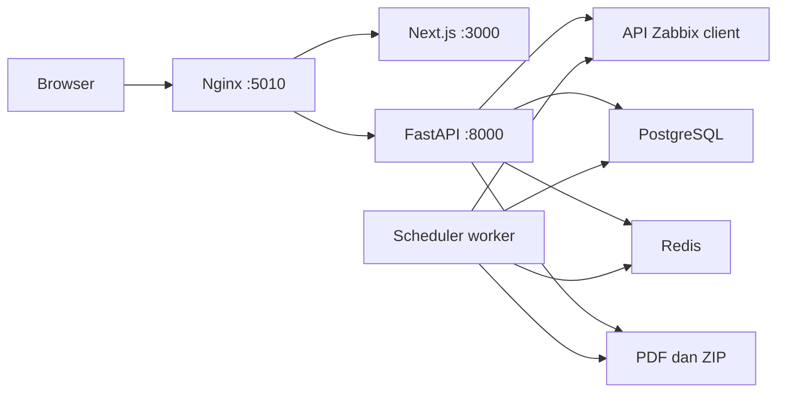

# Implementasi client dan peta base code

## Arsitektur

Hanya Nginx menerbitkan port host. Service Docker saling mengakses melalui nama service; nama container tidak dikunci sehingga beberapa project dapat dijalankan terpisah. Demo memakai file Compose standalone dan API sintetis dalam service `demo-zabbix`.

| Kebutuhan implementasi | File utama |
| --- | --- |
| Identitas produk, organisasi, dan logo | `frontend/lib/branding.ts`, `frontend/public/brand/logo.svg` |
| Dashboard dan ekspor manual | `frontend/app/page.tsx` |
| Gambar grafik dan statistik UI | `frontend/components/Chart.tsx`, `CombinedChart.tsx` |
| Client API browser dan retry GET | `frontend/lib/api.ts` |
| Endpoint laporan dan unduhan | `backend/app/api/v1/reports.py` |
| Grafik PDF dan layout | `backend/app/services/report/pdf.py` |
| Pembacaan history/trend Zabbix | `backend/app/services/zabbix/client.py` |
| Pengumpulan data dan kegagalan metrik | `backend/app/services/report/data.py` |
| Jadwal otomatis serta pemilihan host/metrik | `backend/app/api/v1/auto_schedules.py`, `frontend/components/AutomaticSchedules.tsx` |
| Antrean harian dan retry | `backend/app/services/scheduler/auto.py` |
| Preset kategori host group opsional | `backend/app/services/scheduler/auto.py` (`load_host_groups`), `frontend/components/AutomaticGroupPicker.tsx` |
| Pembuatan ZIP dan pembersihan PDF sementara | `backend/app/services/report/archive.py` |
| Downtime dan durasi | `backend/app/services/report/downtime.py` |
| Login, role, CSRF, dan audit akses | `backend/app/services/access.py`, `backend/app/api/v1/access.py` |
| Database dan migrasi otomatis | `backend/app/core/database.py` |
| Konfigurasi server | `.env.example`, `scripts/configure.py`, `docker-compose.prod.yml` |
| API sintetis untuk belajar | `demo/zabbix.py` |

## Urutan implementasi

1. Jalankan demo dan coba pratinjau, ekspor PDF, serta arsip. Contoh API: `python examples/client.py --output .cache/example.pdf`.
2. Siapkan token baca Zabbix client. Pastikan user pemilik token memiliki akses pada host, item numerik, history/trend, trigger, dan event yang diperlukan.
3. Jalankan generator konfigurasi untuk membuat `.env` baru. Jangan menyalin file `.env` dari client lain.
4. Atur branding; sesuaikan logo dan nama organisasi. Preset kategori CS/TLK/ICON/HYP/MILES bersifat opsional; tanpa preset, pemilihan seluruh host atau pemilihan manual tetap tersedia. Untuk kategori khusus, sesuaikan alias backend dan label frontend bersama-sama.
5. Jalankan Compose produksi. Login sebagai admin, ganti password bootstrap, lalu buat akun operator jika diperlukan.
6. Pilih sumber, host, dan item numerik. Verifikasi IP dan unit pada panel Detail host. ID host/item harus berasal dari sumber yang sama.
7. Pilih periode yang memiliki history. Gunakan tanggal hari ini untuk pemantauan terbaru, dan periksa interval/retensi di Zabbix jika titik data belum tersedia.
8. Buat jadwal dalam keadaan nonaktif terlebih dahulu. Tentukan jam eksekusi, jam data, tanggal berlaku, timezone, host/metrik, serta ZIP; tinjau pilihan lalu aktifkan.
9. Siapkan TLS, backup di luar project, monitoring kapasitas penyimpanan, dan prosedur pemulihan sebelum serah terima.

## Sumber kedua dan sertifikat

Isi `ZABBIX_SECONDARY_URL` dan `ZABBIX_SECONDARY_API_TOKEN` untuk mengaktifkan sumber cadangan. Bila memakai CA internal, simpan sertifikat CA pada `certs/`, lalu arahkan `ZABBIX_SECONDARY_CA_FILE` ke `/run/zabbix-certs/nama-ca.pem`. Backend tidak mematikan verifikasi TLS.

Perkiraan negara IP publik memerlukan database GeoIP lokal yang sesuai lisensinya pada lokasi `GEOIP_DATABASE`. IP private/loopback tidak diterka sebagai suatu negara. Tanpa database GeoIP, fitur lainnya tetap berjalan dan negara dapat tampil tidak diketahui.

## Validasi serah terima

- Grafik dan tabel cocok dengan sampel pada Zabbix untuk host, item, periode, timezone, serta unit yang sama.
- Satu ekspor menghasilkan PDF lengkap; file yang diunduh dari arsip identik.
- Jadwal menjalankan periode kalender sebelumnya sesuai waktu yang dipilih dan mempertahankan status setelah restart.
- Login, role admin/operator, pergantian password, dan penolakan akses tanpa izin diuji pada konfigurasi produksi.
- Backup database dan laporan dapat dipulihkan pada instalasi uji.
